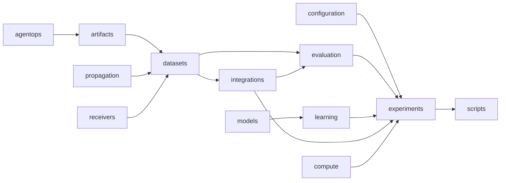

# Architecture

This repository is a research codebase for 5G NR channel-condition learning. It
generates standardized and ray-traced multipath channels, produces receiver
observations from a Sionna-based PUSCH chain, and evaluates models under
protected evaluation contracts. Each layer has one owner; the dependency
direction is enforced by tests.

The full system map, runtime flows, and domain boundaries are in the
[architecture overview](docs/architecture/overview.md). The
[documentation site](docs/index.md) lists every guide, operations document, and
API page.

Package dependency direction (module-level imports, verified by
`tests/architecture`):

Runtime settings belong in `config/` and are read through `configuration/`.
Python packages own implementation. Serialized schemas, causal feature
alignment, and the chronological evaluation order are contracts; change them
only with the protocol that governs them. Repository invariants are in
[AGENTS.md](AGENTS.md).
