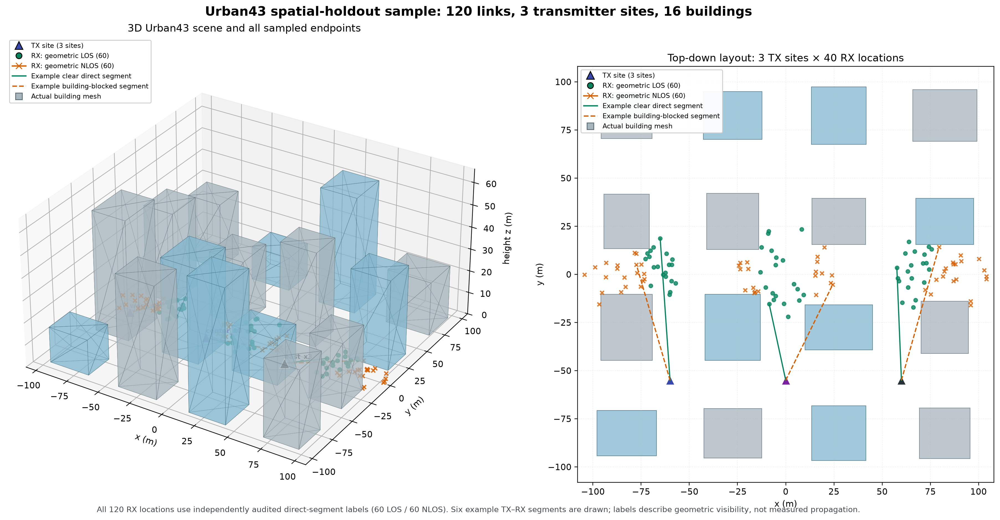

# Start here — reproducible LOS/NLOS research upgrade

All commands run from `long_nguyen_thesis-main/` in Python **3.11+**.

## See the simulated buildings and link geometry



This is a 3D view of the actual generated building meshes. The audit contains
120 receiver locations across three transmitter sites (40 per site), with 60
geometric LOS and 60 geometric NLOS direct-path labels. Solid and dashed
segments show representative clear and building-blocked direct paths; these
are geometry checks, not simulated multipath rays or measured channels. See
the [spatial-holdout report](../research/results/rt-urban43-joint-location-holdout-20261022.json)
and [figure metadata](../research/figures/rt-urban43-spatial-holdout-3d-20261022.json).
The separate [RT depth-convergence plot](../research/figures/rt-box-los-nlos-convergence-depth20-100k-20261022.png)
shows a controlled thin-screen box experiment; its increasing path and delay
statistics through depth 20 are a solver diagnostic, not the building scene.
The [matched scattering-budget plot](../research/figures/rt-box-los-nlos-scattering-budget-verified-20261022.png)
compares zero and synthetic nonzero screen scattering. Its ray-budget response
is still material and the coefficient is not calibrated.

## Build a small receiver-visible PUSCH/DMRS dataset

With the locked Sionna PHY dependencies installed, this command creates four
deterministic TDL-A draws, sends a PUSCH grid through each frequency response,
estimates the channel from DMRS, and stores immutable NR observation records
with a build report:

```bash
uv run --no-sync --locked python scripts/build_standardized_pusch_dataset.py \
  outputs/pusch-tdla-provenance-demo --family tdl --profile A --samples 4 --seed 20261022 \
  --snr-db 20 --device cpu
```

Choose `--family cdl --profile D` to build CDL-D records. The example uses a
12-PRB BWP at 30 kHz and a frozen frequency-domain channel. Noisy receiver
observations and DMRS estimates are stored separately from perfect CFR and
profile-category targets. A profile proxy is not geometric LOS/NLOS. This
build assumes ideal synchronization, one transmit port, and no ICI/ISI, RF
impairments, or calibrated absolute link budget.

## 0. Environment & native requirements

Recommended Linux/WSL2 Ubuntu 24.04 rather than legacy Windows+TensorFlow env.

```bash
python3.11 -m venv .venv
source .venv/bin/activate
python -m pip install -e '.[dev]'
python -m pytest -q
loslab-runtime-inventory --probe-rt-apis
```

For **genuine** standardized TDL/CDL and native ray-tracing generation, separately
install the tested target Sionna version and its native Mitsuba/Dr.Jit/LLVM deps:

```bash
python -m pip install -e '.[sionna]'
loslab-runtime-inventory --probe-rt-apis
```

Sionna 2.2 PHY requires a compatible PyTorch runtime. Install a tested PyTorch
wheel for your GPU/driver instead of blindly mixing CUDA versions. RT generation
probes Mitsuba's CUDA/OptiX path and uses LLVM on CPU when that path cannot run;
check the actual host with `loslab-runtime-inventory --probe-rt-apis`. Check
`https://nvlabs.github.io/sionna/v2.2.0/installation.html` before deployment.

For a Tesla V100 (compute capability 7.0), use a Volta-enabled wheel such as
PyTorch 2.10.0 with CUDA 12.8; PyTorch 2.11 CUDA 12.8 wheels dropped Volta
kernels. After installing the project extras, an isolated environment can be
overridden with:

```bash
uv pip install --python .venv/bin/python \
  --index-strategy unsafe-best-match \
  --index-url https://download.pytorch.org/whl/cu128 \
  --extra-index-url https://pypi.org/simple \
  'torch==2.10.0+cu128'
```

Check `torch.cuda.get_arch_list()` includes `sm_70` and run a small CUDA tensor
operation before native PHY work. This Torch wheel supports Sionna PHY on V100;
the prebuilt Mitsuba CUDA variant still requires compute capability 7.5 or
newer, so RT uses its LLVM CPU backend on this GPU. See the [PyTorch CUDA
support matrix](https://github.com/pytorch/pytorch/blob/main/RELEASE.md#pytorch-cuda-support-matrix).

## 1. Generate ray-traced data with built-in urban geometry (real RT required)

```bash
python scripts/generate_rt_dataset.py --scene munich --tx 8.5 21 27 \
  --center 44 95 1.5 --radius 90 --per-class 150 \
  --samples-per-src 120000 --output data/rt_munich_42.npz --seed 42
```

The default **requires a LOS example to have a direct + indirect ray**. If a
scene does not yield both classes within `--max-attempts`, generation fails with
an explicit error rather than silently imbalancing the dataset.
The saved NPZ also carries a dataset-level `generation_report` with candidate,
quota, empty-full-solver, direct-only rejection, and CFR-conversion counts,
along with the scene/grid/solver configuration, environment versions, and a
source-code hash. Empty-path outcomes are counted but are not exported as
channel observations. Older NPZ files without this report still load; dataset
selection and concatenation preserve derivation lineage.

Production generation requires a qualification approval manifest. Without one,
the command runs only in pilot mode (`--pilot`), which is bounded and writes
exploratory output only.

## 2. Feed RT channels through the NR PUSCH/DMRS receiver

Convert one or more compatible RT CFR datasets into receiver-visible PUSCH
DMRS channel estimates, then run the grouped experiment pipeline:

```bash
python scripts/generate_rt_dmrs_observations.py \
  --input data/rt_munich_42.npz \
  --output data/rt_munich_pusch_dmrs_12db.npz \
  --snr-db 12 --seed 42022 --device cuda:0
```

The observation builder records its receiver configuration and preserves the
geometric-label semantics and scene groups. This path assumes ideal
synchronization and normalizes each link to unit channel power, so it evaluates
CFR shape without path-loss or outage information. A small smoke run verifies
software plumbing only; independent scenes, qualified materials, convergence,
receiver impairments, and measurements remain necessary for scientific claims.

## 3. Run the grouped experiment with a locked holdout domain

```bash
python scripts/run_channel_experiment.py \
  --input data/rt_munich_pusch_dmrs_12db.npz \
  --holdout rt_munich --output outputs/rt_munich_holdout \
  --methods rf mlp raw_mlp --seeds 11 23 47 --bootstrap 400
```

Use the domain name stored in the dataset for `--holdout`. Do not tune the method
using the holdout labels and then report it as unseen. The holdout must remain a
locked test set. The experiment settings can also be given in a versioned
configuration file with `--config`.

## Output contract

- `manifest.json`: source SHA256, parameters, environment versions.
- `results.json`: full per-seed/per-method metrics and provenance.
- `summary.json`: means and paired-seed deltas + exact sign-flip p-values.
- `<method>_seed<seed>_predictions.npz`: exact split indices and probabilities.
- `<method>_seed<seed>.joblib` or `.pt`: trained model checkpoints.
- `<method>_seed<seed>_modelinfo.json`: sklearn checkpoint feature/threshold metadata.
- All reports include a package-source SHA256 even without Git history.

Do not tune the method using `rt_urban_00043` labels and then report it as
unseen. It must remain a locked test set.
