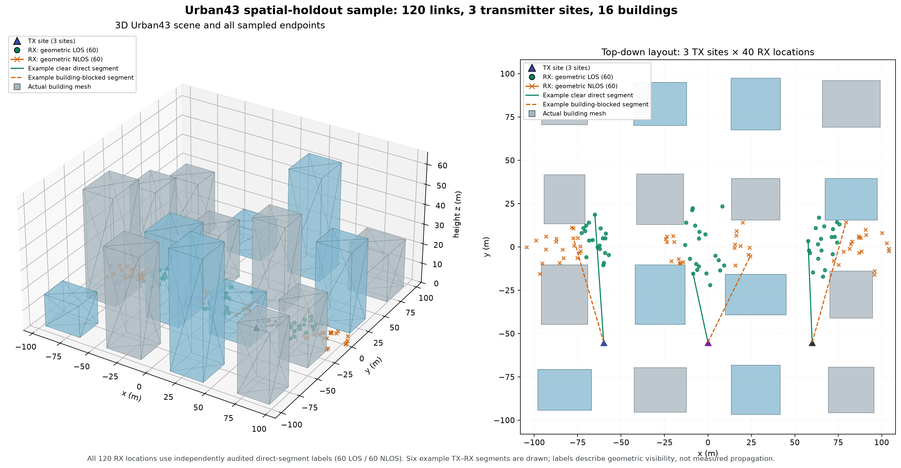

# Start here — reproducible LOS/NLOS research upgrade

All commands run from `long_nguyen_thesis-main/` in Python **3.11+**.

## See the simulated buildings and link geometry



This is a 3D view of the actual generated building meshes. The audit contains
120 receiver locations across three transmitter sites (40 per site), with 60
geometric LOS and 60 geometric NLOS direct-path labels. Solid and dashed
segments show representative clear and building-blocked direct paths; these
are geometry checks, not simulated multipath rays or measured channels. See
the [spatial-holdout report](results/rt-urban43-joint-location-holdout-20261022.json)
and [figure metadata](figures/rt-urban43-spatial-holdout-3d-20261022.json).

## Build a small receiver-visible PUSCH/DMRS dataset

With the locked Sionna PHY dependencies installed, this command creates four
deterministic TDL-A draws, sends a PUSCH grid through each frequency response,
estimates the channel from DMRS, and stores immutable NR observation records
with a build report:

```bash
uv run --no-sync --locked python scripts/build_standardized_pusch_dataset.py \
  outputs/pusch-tdla-demo --family tdl --profile A --samples 4 --seed 20261022 \
  --snr-db 20 --device cpu
```

Choose `--family cdl --profile D` to build CDL-D records. The example uses a
12-PRB BWP at 30 kHz and a frozen frequency-domain channel. Noisy receiver
observations and DMRS estimates are stored separately from perfect CFR and
profile-category targets. A profile proxy is not geometric LOS/NLOS. This
build assumes ideal synchronization, one transmit port, and no ICI/ISI, RF
impairments, or calibrated absolute link budget.

## 0. Environment & native requirements

Recommended Linux/WSL2 Ubuntu 24.04 rather than legacy Windows+TensorFlow env.

```bash
python3.11 -m venv .venv
source .venv/bin/activate
python -m pip install -e '.[dev]'
python -m pytest -q
python -m loslab doctor
```

For **genuine** standardized TDL/CDL and native ray-tracing generation, separately
install the tested target Sionna version and its native Mitsuba/Dr.Jit/LLVM deps:

```bash
python -m pip install -e '.[sionna]'
python -m loslab doctor
```

Sionna 2.2 PHY requires a compatible PyTorch runtime. Install a tested PyTorch
wheel for your GPU/driver instead of blindly mixing CUDA versions. RT generation
probes Mitsuba's CUDA/OptiX path and uses LLVM on CPU when that path cannot run;
check the actual host with `python -m loslab doctor --probe-rt`. Check
`https://nvlabs.github.io/sionna/v2.2.0/installation.html` before deployment.

## 1. Run a zero-dependency end-to-end smoke experiment

```bash
python -m loslab debug-data --output data/examples/debug_channels.npz --scenes 6
python -m loslab experiment --config config/experiments/debug_smoke.yaml
```

All output is **DEBUG_ONLY**. It is explicitly not 3GPP, not Sionna RT and not
valid evidence for the paper.

The example config runs logistic regression for one seed to validate the
pipeline quickly. Add model variants and prespecified seeds for actual studies.

The following receiver-observability stress test adds generic QPSK comb pilots,
AWGN, least-squares pilot estimates and frequency interpolation:

```bash
python -m loslab experiment --input runs/debug_data.npz \
  --output runs/debug_comb_ls --holdout debug_scene_5 \
  --observation comb_ls --pilot-spacing 4 --pilot-snr-db 7 \
  --methods logreg mlp coral0 coral --seeds 11 23 --bootstrap 100
```

This is **not** a compliant 3GPP TS 38.211 DMRS pilot mask; use a proper Sionna
PUSCH/DMRS/PRS receiver before asserting 5G NR physical-layer performance.

## 2. Generate stochastic 3GPP channel data (real Sionna 2.2 required)

```bash
python -m loslab phy-data --output data/tdl_cdl_42.npz \
  --samples-per-profile 200 --seed 42 --device cpu --spec-version 19.2
```

This covers TDL-A/B/C/D/E and CDL-A/B/C/D/E. The labels remain **profile proxies**
(LOS profiles D/E and NLOS profiles A/B/C), not geometrically measured visibility.

## 3. Generate ray-traced data with built-in urban geometry (real RT required)

```bash
python -m loslab rt-data --scene munich --tx 8.5 21 27 \
  --center 44 95 1.5 --radius 90 --per-class 150 \
  --samples-per-src 120000 --output data/rt_munich_42.npz --seed 42
```

The default **requires a LOS example to have a direct + indirect ray**. If a
scene does not yield both classes within `--max-attempts`, generation fails with
an explicit error rather than silently imbalancing the dataset.
The saved NPZ also carries a dataset-level `generation_report` with candidate,
quota, empty-full-solver, direct-only rejection, and CFR-conversion counts,
along with the scene/grid/solver configuration, environment versions, and a
source-code hash. Empty-path outcomes are counted but are not exported as
channel observations. Older NPZ files without this report still load; dataset
selection and concatenation preserve derivation lineage.

## 3b. Feed RT channels through the NR PUSCH/DMRS receiver

Convert one or more compatible RT CFR datasets into receiver-visible PUSCH
DMRS channel estimates, then run the same grouped experiment pipeline:

```bash
python -m loslab nr-observe \
  --input data/rt_city41.npz data/rt_city42.npz data/rt_city43.npz \
  --output data/rt_cities_pusch_dmrs_12db.npz \
  --snr-db 12 --seed 42022 --device cuda:0

python -m loslab experiment \
  --input data/rt_cities_pusch_dmrs_12db.npz \
  --holdout rt_urban_00043 --output outputs/rt_dmrs_city43_holdout \
  --methods logreg rf mlp raw_mlp --seeds 11 23 47 --bootstrap 400
```

The observation builder records its receiver configuration and preserves the
geometric-label semantics and scene groups. This path assumes ideal
synchronization and normalizes each link to unit channel power, so it evaluates
CFR shape without path-loss or outage information. A small smoke run verifies
software plumbing only; independent scenes, qualified materials, convergence,
receiver impairments, and measurements remain necessary for scientific claims.

## 4. Generate independent, controllable city geometries (no Sionna needed)

```bash
python -m loslab city-scene --output-dir scenes/city41 --seed 41 --grid-size 5 --vehicles 12
python -m loslab city-scene --output-dir scenes/city42 --seed 42 --grid-size 5 --vehicles 12
python -m loslab city-scene --output-dir scenes/city43 --seed 43 --grid-size 5 --vehicles 12
```

Then, **after native Sionna RT installation and visual scene inspection**:

```bash
python -m loslab rt-data --scene scenes/city41/urban_00041.xml \
  --tx 27.5 -82.5 18 --center 27.5 27.5 1.5 --radius 105 \
  --per-class 150 --samples-per-src 250000 --max-attempts 10000 \
  --output data/rt_city41.npz --seed 41
# Repeat for cities 42 and 43; HOLD OUT all samples from city 43.
```

The procedural scenes include independently generated buildings, metal vehicles,
heights and ITU material assignments, saved OBJ files, XML and a SHA256 scene
manifest. They are **controlled synthetic environments**, not verified real city
models. If a geometry produces too few LOS/NLOS examples, improve the TX/RX
placement and scene sampling. Do not relabel examples based on channel power.

## 5. Predefined zero-shot domain-shift benchmark

```bash
python -m loslab experiment \
  --input data/tdl_cdl_42.npz data/rt_city41.npz data/rt_city42.npz data/rt_city43.npz \
  --holdout rt_urban_00043 --output runs/scene_43_holdout \
  --methods rf mlp coral0 coral \
  --seeds 11 23 47 59 71 83 97 101 109 127 --bootstrap 400
```

This is **NOT** sufficient for claiming S-tier results by itself. Add true NR
PUSCH/DMRS/PRS receiver errors and independently measured channels.

## Output contract

- `manifest.json`: source SHA256, parameters, environment versions.
- `results.json`: full per-seed/per-method metrics and provenance.
- `summary.json`: means and paired-seed deltas + exact sign-flip p-values.
- `<method>_seed<seed>_predictions.npz`: exact split indices and probabilities.
- `<method>_seed<seed>.joblib` or `.pt`: trained model checkpoints.
- `<method>_seed<seed>_modelinfo.json`: sklearn checkpoint feature/threshold metadata.
- All reports include a package-source SHA256 even without Git history.

Do not tune the method using `rt_urban_00043` labels and then report it as
unseen. It must remain a locked test set.
